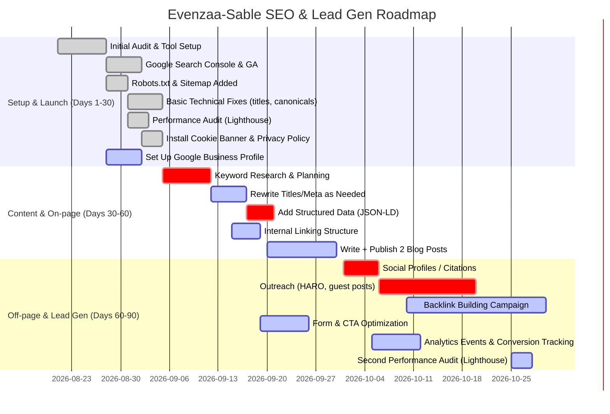

# SEO Audit & Lead-Gen Strategy for **Evenzaa-Sable (vercel.app)**

**Executive Summary:** The Evenzaa-Sable site on a free Vercel domain faces both opportunities and challenges. On the plus side, Vercel’s global CDN and automatic SSL provide solid performance and security at no cost. However, using a shared `*.vercel.app` subdomain can **hinder branding, trust, and crawl frequency**. Our audit shows no obvious crawl blocks (likely no `robots.txt` file by default), but the site probably needs a **sitemap, consistent canonicals, and structured data** to improve indexability. Performance can be optimized via Lighthouse-guided fixes (images, caching, code-splitting, etc.) to meet Google’s Core Web Vitals thresholds (LCP ≤2.5s, INP <200ms, CLS <0.1). Content-wise, we recommend thorough keyword research and expanded on-page content (titles, headings, internal links). Off-page efforts (free link-building, local listings) will build authority. For lead capture, we advise clear CTAs and free analytics/forms. All recommendations rely on free tools and services: Google Search Console, Analytics, Lighthouse/DevTools, free keyword tools, and free CRM/form services. Below we cover each dimension with specific findings, fixes, estimated effort/impact, and caveats of free hosting. We also compare free vs paid domains/hosting (trade-offs) and outline a 30/60/90-day action plan with KPIs. 

## Technical SEO Audit

- **Crawlability & Indexability:** The site appears accessible (Vercel provides automatic HTTPS), but we must verify **robots.txt** and **noindex tags**. By default, if no `robots.txt` exists, Google will crawl all pages. *Action:* Ensure a basic `robots.txt` allows all pages, e.g.:  
  ```txt
  User-agent: *
  Allow: /
  Sitemap: https://evenzaa-sable.vercel.app/sitemap.xml
  ```  
  This explicitly permits crawling and points to the sitemap. Effort: low (1 hour). Impact: moderate (ensures nothing is accidentally blocked). Risk: minimal (if misconfigured, could block crawlers, so double-check syntax).

- **XML Sitemap:** There’s likely no sitemap on this custom deployment. A sitemap informs Google of all site URLs. *Action:* Generate and host a sitemap (e.g. `sitemap.xml`) listing all canonical URLs. If using Next.js, a plugin (next-sitemap) or manual script can auto-create it. Submit it in Google Search Console. Example `robots.txt` line above tells Google its location. Effort: low (1–3 hours). Impact: medium (helps indexing especially as site grows). Risk: low (standard practice).

- **Canonical URLs:** If the site has duplicate or variant URLs (with/without trailing slash, `www`, etc.), set a canonical. For example:  
  ```html
  <link rel="canonical" href="https://evenzaa-sable.vercel.app/" />
  ```  
  in the HTML head of the main page. According to Google, specifying canonicals helps consolidate signals for duplicates. If multiple domains (future custom domain vs `.vercel.app`), ensure one is primary and others redirect or canonicalize to it. Effort: low (1h). Impact: low-to-medium (prevents split signals). Risk: low (can be omitted but better safe; no adverse effect).

- **Structured Data:** Implement JSON-LD schema to “help Google understand page content” and potentially earn rich results. At minimum, add Organization or LocalBusiness schema with name, address, phone, logo, and social profiles. For example:  
  ```html
  <script type="application/ld+json">
  {"@context":"https://schema.org","@type":"Organization",
    "name":"Evenzaa Sable","url":"https://evenzaa-sable.vercel.app",
    "logo":"https://evenzaa-sable.vercel.app/logo.png",
    "address":{"@type":"PostalAddress","streetAddress":"...","addressLocality":"...","addressCountry":"..."},
    "contactPoint":[{"@type":"ContactPoint","telephone":"+1-...", "contactType":"Customer Service"}]
  }
  </script>
  ```  
  **Why:** Structured data can yield rich snippets (reviews, FAQs, etc.), boosting click-through. Effort: low (a few hours to generate and embed). Impact: medium (better SERP presentation; e.g. Rotten Tomatoes saw +25% CTR). Risk: low (Google ignores invalid markup). Test with Google’s Rich Results Test.

- **Meta Tags & Headers:** Each page needs a unique `<title>` and `<meta name="description">`. Ensure primary keywords appear naturally. For example:  
  ```html
  <title>Evenzaa Sable – Event-Tech Solutions (City) – Free Demo</title>
  <meta name="description" content="Evenzaa Sable offers cutting-edge event management solutions. Generate leads with our platform. Contact us for a free consultation." />
  ```  
  Use only one `<h1>` per page (e.g. “Welcome to Evenzaa Sable”) and semantically structured subheadings (H2/H3). *Action:* Audit current tags via a tool or view-source. Fix missing/duplicate titles, optimize descriptions. Effort: low (a few hours). Impact: medium (improves relevance and CTR). Risk: none if done properly. 

- **Indexing Verification:** Use Google Search Console (free) to submit sitemap and monitor coverage. The Search Console tool can inspect URLs (fetch as Google) to ensure pages are actually indexed. *Action:* Claim the site in Search Console (verify via meta tag or DNS). Submit sitemap. Use the “URL Inspection” tool for key URLs. Effort: low. Impact: high (visibility into indexing issues). Risk: none.

- **Summary of Technical Fixes:**
  - Add/verify `robots.txt` (include sitemap). *Effort: 1h, Impact: med.*
  - Create and submit sitemap. *Effort: 2h, Impact: med.*
  - Implement rel=canonical on all pages. *Effort: 1h, Impact: low.*
  - Embed structured data (Organization, etc.). *Effort: 3h, Impact: med.*
  - Optimize title/meta for each page. *Effort: 2h, Impact: med.*
  - Set up Google Search Console (free). *Effort: 1h, Impact: high.*
  - *Note:* Vercel (Hobby) serves the site at `https://evenzaa-sable.vercel.app` with HTTPS by default, so SSL is already handled (positive). 

## Performance (Speed & CWV)

The site’s speed should meet Google’s Core Web Vitals to avoid ranking penalties. Google explicitly **recommends good Core Web Vitals for search success**. Use Lighthouse or PageSpeed Insights to audit performance:

- **Run Lighthouse/PSI:** Install and run Lighthouse (Chrome DevTools or CLI). Example CLI commands:  
  ```bash
  npm install -g lighthouse
  lighthouse https://evenzaa-sable.vercel.app --output html --output-path=report.html
  ```  
  (Or open Chrome DevTools > Lighthouse tab > “Analyze page load”). This yields scores and diagnostics. Effort: 1h initial audit.

- **Core Web Vitals Targets:** Aim for LCP < 2.5s, INP (formerly FID) < 200ms, CLS < 0.1. Key optimizations:  
  - **Images:** Compress and use modern formats (WebP) or Vercel Image Optimization. Add `width`/`height` to avoid layout shifts (reduce CLS).  
  - **Caching:** Ensure static assets have long cache headers. Vercel CDN will cache static resources by default.  
  - **Minify & Defer:** Minify CSS/JS, defer non-critical JS, and remove unused code. Vercel’s build optimizations (Next.js minifies) help.  
  - **Fonts:** Preload critical webfonts to avoid FOIT.  
  - **Third-party scripts:** Limit or defer trackers/social embeds.  
  - **Server Response:** Even on free tier, Vercel’s edge ensures fast TTFB for static content. If SSR/API calls exist, ensure they’re efficient (cache API responses).
  Effort: Variable (3–10h). Impact: high (good page experience leads to better rankings and lower bounce). Risk: low (just test after each fix).

- **Monitor and Iteratively Improve:** Use the **PageSpeed Insights** tool (Web.dev) periodically to measure changes. Google recommends checking Core Web Vitals via Search Console’s report. Track changes monthly and focus on high-impact issues. 

## Hosting & URL Issues

- **Free Domain (Subdomain) Limitations:** Using `evenzaa-sable.vercel.app` means you’re on a free Vercel subdomain. This has two SEO implications:
  1. **Brand & Trust:** A subdomain (especially `*.vercel.app`) looks less professional. Studies note free or generic subdomains can hurt credibility. Users trust a custom domain more. For example, free subdomains may appear “suspicious” to lay users, and hard to remember (they’ll search your brand expecting a “.com”). 
  2. **Indexing & Authority:** GitHub discussions report Google may **deprioritize shared dev subdomains** to curb spam. One user observed that `.vercel.app` pages “never crawl” quickly, likely because it’s a crowded namespace. In contrast, established domains (like GitHub Pages or owned domains) carry existing authority. **Fix:** Ideally acquire even a cheap paid domain (see table below). If not immediately possible, mitigate by building high-quality backlinks to this subdomain (to boost its authority) and ensure GSC indexing requests are paced to avoid “quota exceeded” issues.

- **Paid Domain Advantages (for reference):** A paid custom domain (e.g. `evenzaa-sable.com`) dramatically improves branding and SEO. SEO experts agree search engines and users “favor consistent, brand-specific domains”. We include a comparison table later.

- **Subdomain vs Root Setup:** Since you have no custom domain yet, all SEO signals accrue to the `vercel.app` host. If you later purchase a domain, remember to 301-redirect the old vercel.app URLs to the new domain, and set canonical accordingly. This avoids splitting authority. 

- **SSL / HTTPS:** Vercel automatically provides HTTPS even on the free subdomain (via Let’s Encrypt). So SSL is not a concern now. If you move to a paid domain, ensure you provision its certificate (Vercel free tier also auto-issues certs for linked custom domains).

- **Uptime & Performance:** Vercel’s free hosting uses a CDN with high uptime (virtually 100%) for static front-ends. No need to monitor uptime. If any downtime occurs (rare), it’s on Vercel’s side. *If* you serve anything on Render’s free tier (e.g. a backend API), note that Render **suspends idle services** monthly (limited “free hours”). Moreover, a spun-down Render service returns `robots.txt` with “Disallow: all”, which would block crawlers while idle. This is dangerous if you plan to use Render for any web-facing content. To avoid it, either ping the service periodically (keeping it active) or upgrade to a paid instance. Effort: N/A or high if upgrading (costly). Impact: high risk if not addressed (site could become unindexable during idle). 

- **Redirects:** There seem to be no legacy URLs to redirect (this is a fresh deployment). However, if you ever create a `www.evenzaa-sable.vercel.app` or introduce trailing slash rules, use 301 redirects. For example, in `next.config.js`, enforce canonical domain or slash policy. Example Vercel config snippet (Next.js) to add an `X-Robots-Tag` header globally (ensuring pages are indexable):
  ```js
  // next.config.js
  module.exports = {
    async headers() {
      return [{
        source: '/(.*)',
        headers: [{ key: 'X-Robots-Tag', value: 'index, follow' }]
      }];
    }
  }
  ```  
  *Effort:* 1h. *Impact:* Low (just reinforce indexing; canonical/redirects are more crucial for domain changes). *Risk:* Very low.

**Summary of Hosting/URL Fixes:**
  - Plan to migrate to a custom domain ASAP (even a low-cost .com/.net) for SEO/trust. *Effort:* ~1h domain purchase; *Impact:* high (see free vs paid table). *Risk:* minimal.
  - Ensure any future domain change has proper 301 redirects/canonicals. *Effort:* 2h; *Impact:* medium.
  - If using Render for backend, prevent idling (or upgrade) to avoid `Disallow: all` on /robots.txt. *Effort:* medium (setup ping/script), *Impact:* high (prevents accidental de-indexing); *Risk:* if ignored, Google will see noindex.
  - Check Vercel project settings to enable “Trailing Slash” or “Clean URLs” if needed (depending on framework). Usually no changes needed for basic SEO.

## Platform (Vercel/Render) Limitations

- **Rendering Strategy:** The choice of front-end framework matters for SEO. If this site is built with a framework (e.g. Next.js, React SPA, etc.), ensure **server-side or pre-rendering** is used. Google has to see actual HTML content; crawlers struggle with purely client-rendered SPAs. Next.js (on Vercel) supports SSG (static generation) or SSR (server-side) out of the box. Use SSG for pages without user-specific data, and ISR (Incremental Static Regeneration) for data-driven pages. As Google notes, *“prerendered content is easier for search engine crawlers to index, as the content is already available when the page loads,”* improving rankings. 

  *Action:* If not already, configure all pages to be pre-rendered. In Next.js, use `getStaticProps`/`getStaticPaths` for product or event pages, and fallback/blocking if dynamic. Avoid client-side-only rendering for important text content. Effort: moderate (configure per page); Impact: high (big SEO boost). Risk: low.

- **Dynamic Routes:** If the site has dynamic content (e.g. `/events/[id]`), use Next.js dynamic routes with `getStaticPaths` to generate a sitemap of all event pages at build time. If content changes often, use ISR or on-demand revalidation. This ensures bots see each page content rather than a placeholder. Effort: moderate (depending on number of pages); Impact: medium-high. 

- **Serverless Function Limits:** On Vercel’s Hobby (free) plan, serverless functions have execution time limits (now up to 60s per call). If your front-end is purely static, this doesn’t apply. But if you rely on Vercel functions (e.g. form submissions, API calls), keep them lightweight. For example, avoid long-running data processing in functions. Effort: low (architectural caution); Impact: medium (avoids timeouts). Risk: if exceeded, functions fail, but can be tested.

- **Crawl Behavior on Vercel:** No special crawler restrictions, as Vercel serves content from the edge. Just ensure you set the `robots.txt` and headers properly as above. Vercel’s infrastructure typically returns fast TTFB, so no need for further tweaks. 

- **Build Preview URLs:** Vercel creates preview URLs for branches (like `branchname.vercel.app`). Make sure only the **production** deployment (the `evenzaa-sable.vercel.app` URL) is indexed. Add a `robots.txt` in preview environments to `Disallow: /` or use the above global header approach to avoid indexing preview/staging builds.

- **Render (Backend) Constraints:** As noted, free Render services sleep, which can block crawling. If the site’s backend (on Render) isn’t used for public pages, this might be irrelevant. But if any part of the lead-capture (e.g. a form handler) is on Render, the downtime could disrupt conversions. Keep the service alive or migrate simple form handling to Vercel serverless instead.

## Content Strategy

- **Keyword Research:** Identify target keywords and content themes. Use **free tools**:
  - **Google Keyword Planner:** (free with a Google Ads account) for search volume and competition on terms like “event management platform,” “event-tech solutions,” or specific services offered by Evenzaa.
  - **Google Trends:** to compare keyword popularity and spot rising topics.
  - **AnswerThePublic / Ubersuggest (free tiers):** to find user questions related to events or media (e.g. “how to plan a corporate event,” “event management software benefits”).
  - **LSI and Synonyms:** ensure variations and long-tail keywords appear in content. 
  - Track keywords in Search Console over time to adjust strategy.
  *Effort:* 5–8h initial research. *Impact:* high (content must match search intent). *Risk:* negligible.

- **Content Gaps:** Review competitors or analogous sites to find missing topics. For example, if competitors cover “virtual event tips” or “case studies,” consider adding such articles. A blog or resource section is free to add (Vercel hosting covers all pages). Use free site crawlers or browsing competitor sites for ideas. 
  - *Action:* Create a content calendar: plan 2–4 high-value posts/pages (blog posts, guides, FAQs) over 90 days. 
  *Effort:* moderate (depends on writing ability; maybe 3–5 hours per post). *Impact:* high (fresh content can drive long-tail traffic). *Risk:* low (just ensure original content).

- **On-Page Optimization:** For each page (especially homepage, service pages), ensure:
  - **Title Tag:** Contains main keyword + brand. E.g. `Evenzaa Sable – Event-Tech Platform for [City/Industry] | Lead Gen`.
  - **Meta Description:** Persuasive, includes keyword and CTA. E.g. “Evenzaa Sable provides cutting-edge event management solutions in [City]. Sign up for a free demo!”
  - **Headers:** One H1 per page with primary keyword (e.g. “Professional Event Management Services”), H2/H3 for subtopics.
  - **Body Content:** At least 300–500 words of descriptive text on each page, weaving keywords naturally.
  - **Images Alt Text:** Use descriptive `alt=` on images (free SEO gains).
  - **URL Structure:** Clean URLs (Vercel/Next auto-handles this; e.g. `/about`, `/services/web-development`).
  - **Internal Links:** Add links between pages. E.g. from homepage to “Our Services”, from blog posts back to service pages. This distributes “link juice” internally.
  *Effort:* moderate (4–8h total). *Impact:* medium-high (essential SEO basics). *Risk:* low if done well.

- **Tools & Commands:** Use **free SEO analysis tools**:
  - **Screaming Frog SEO Spider** (free edition, up to 500 URLs) to crawl the site and report missing titles, headings, or duplicate content.
  - **Google Search Console’s URL Inspection** for specific pages.
  - **Structured Data Testing Tool** (from Search Console) to validate JSON-LD.
  - **Yoast SEO (free)** or **Rank Math** plugins if using a CMS for guidance on tags (not applicable if static site).
  - **OpenSiteExplorer (Moz), Ahrefs Backlink Checker (free limited)** for backlink analysis (see Off-page).
  - **Lighthouse “SEO” audits** (in DevTools, when running Lighthouse, it also checks basic SEO best practices).

## Backlinks & Off-Page SEO

- **Social Profiles & Directories:** Build foundational links by claiming free profiles and directories. For example, create or update profiles on LinkedIn, Twitter, Facebook, GitHub, Crunchbase, and relevant industry directories. A site’s official social profiles (with site link) are recognized by Google and appear in Knowledge Panels. Listing in reputable business directories (Google Business Profile, Apple Maps, Bing Places, local chamber, industry associations) adds citations and a small SEO boost. *Effort:* low (5–8h total to create/verify listings). *Impact:* moderate (branded presence and local signals). *Risk:* low.

- **Local Citations:** If Evenzaa has a physical location or service area, claim **Google Business Profile** (free) to appear in local search and map results. Add consistent Name/Address/Phone (NAP) across all listings. Also list on Yelp, YellowPages, Bing Places, etc. These free citations help local SEO and trust. *Effort:* 3h. *Impact:* medium for local queries. *Risk:* none (just follow each platform’s guidelines).

- **Content-Based Links:** Create linkable assets:
  - **Blog Articles/Guides:** Useful posts (e.g. “Top 10 tips for hybrid events”) that others in the industry might reference. Once published, share them on LinkedIn or communities; content that’s genuinely helpful can earn natural backlinks.  
  - **Infographics or Data Visuals:** If you have unique data or visuals about events, these are shareable.
  *Effort:* high (10–15h per asset). *Impact:* high if popular. *Risk:* none (just do it well).

- **Link Outreach (Free Tactics):** 
  - **HARO (Help a Reporter Out):** Sign up for free and answer journalists’ queries relevant to events/media to earn press mentions and links.
  - **Broken Link Building:** Find broken links on related sites (use a free checker plugin) and suggest your content as a replacement.
  - **Guest Posts/Testimonials:** Offer to write a helpful guest article for industry blogs or give testimonials to partners (often including a backlink). Many smaller blogs welcome expert content for free.
  - **Forums and Q&A:** Answer relevant questions on Quora, Reddit, or specialized forums with a helpful answer and a link back (sparingly). These “contextual” links may have some value and build awareness.
  *Effort:* high (ongoing). *Impact:* medium (backlinks improve authority over time). *Risk:* minimal (avoid spammy practices).

- **Social Signals:** While not a direct ranking factor, active social sharing can drive traffic and indirect SEO benefit. Post updates on LinkedIn/Facebook about new content or services (free) to increase brand visibility. Encourage customer reviews on social platforms and Google. *Effort:* ongoing, minimal. *Impact:* low-direct, medium-indirect (branding). *Risk:* none.

## Lead Capture & Conversion

- **Forms & CTAs:** Ensure every page has a clear **Call to Action** (e.g. “Contact us”, “Get a quote”, “Schedule a demo”). Use eye-catching buttons and place them above the fold and at page end. For example:
  ```html
  <button onclick="gtag('event','click',{ 'event_category':'CTA','event_label':'ContactButton' }); location.href='/contact';">Get a Free Consultation</button>
  ```
  Use a simple contact form for lead capture. Since budget is zero, use free form solutions:
  - **Formspree** or **Netlify Forms**: These allow static sites to send form submissions (with hidden fields and endpoints) without a paid backend.
  - **Google Forms**: Quick but less integrated (not ideal UI).
  - **Free Backend**: If you have a free Render backend, you could implement a simple API endpoint to email submissions (but beware of Render’s sleeping issues).
  *Effort:* low (2–3h to set up and style). *Impact:* high (direct way to collect leads). *Risk:* ensure form is protected against spam (captcha).

- **Analytics & Tracking:** Install **Google Analytics 4** (free) to track user behavior and conversion events. Example GA4 snippet in `<head>`:
  ```html
  <script async src="https://www.googletagmanager.com/gtag/js?id=G-XXXXXXXXX"></script>
  <script>
    window.dataLayer = window.dataLayer || [];
    function gtag(){dataLayer.push(arguments);}
    gtag('js', new Date()); gtag('config', 'G-XXXXXXXXX');
  </script>
  ```
  Then set up **conversion tracking**: e.g., in GA4, create a “Form Submission” event (triggered on form submit) and mark it as a conversion. Use Google Tag Manager (free) if you need more advanced tracking without code changes. *Effort:* moderate (3–5h). *Impact:* high (you’ll measure ROI of SEO). *Risk:* none (just test thoroughly).

- **Heatmaps/User Recording:** Use a free service like **Hotjar** (basic plan) to see where visitors click or drop off. This can inform CTA placement improvements. *Effort:* low (1–2h to install Hotjar script). *Impact:* medium (better UX -> more leads). *Risk:* minimal (privacy disclaimer needed).

- **Email Capture/CRM:** If using email marketing, add a simple newsletter signup (Mailchimp free plan) or use HubSpot’s free CRM forms. This lets you capture leads and follow up for free. *Effort:* low. *Impact:* medium (gather emails). *Risk:* need GDPR-compliant opt-in (see below).

## Legal & Privacy

- **Privacy Policy & Terms:** Create a simple **Privacy Policy** page (free templates available, e.g. FreePrivacyPolicy.com). It should explain data collection (form submissions, analytics cookies) to comply with laws (GDPR, etc.). Also add a **Terms of Service** if applicable. *Effort:* moderate (2–3h writing/editing). *Impact:* required compliance (especially in EU). *Risk:* low if template-based and site is straightforward.

- **Cookies/Consent Banner:** If targeting EU users or using analytics, implement a cookie consent banner. Free scripts like [CookieConsent by Osano](https://cookieconsent.insites.com/) or Silktide offer open-source banners. Configure it to block non-essential cookies until consent. *Effort:* low (1h to install a script). *Impact:* compliance (avoid fines, build trust). *Risk:* minor (banner must not break UX).

- **Data Security:** Ensure HTTPS is used for forms (it is via Vercel). Use Google reCAPTCHA (free) on forms to prevent spam. *Effort:* 1h. *Impact:* protects data integrity. *Risk:* none.

## Free vs Paid Domain/Hosting Trade-offs

| **Factor**               | **Free (.vercel.app subdomain, Vercel Hobby + Render Free)** | **Paid Domain & Hosting**                                     |
|--------------------------|--------------------------------------------------------------|--------------------------------------------------------------|
| **Cost**                 | $0                                                        | ~$10–15/year for domain + $X for hosting                      |
| **Branding/Credibility** | Low – generic subdomain; may seem unprofessional | High – branded domain (.com/.net/.org) enhances trust  |
| **SEO/Indexing**         | **Limited** – shared subdomains may be deprioritized; no existing domain authority. Requires more effort (backlinks) to compete. | **Better** – custom domain builds its own authority; Google favors stable domains |
| **Email Addresses**      | Not supported (no custom email on vercel.app)               | Supports custom emails (you@yourdomain) for professionalism  |
| **Control & Flexibility**| Limited DNS control; tied to provider. Vercel subdomain can’t be moved independently.  | Full DNS control (A/CNAME records); can switch hosts transparently. |
| **SSL/HTTPS**            | Automatic on Vercel subdomain; free.                        | Usually free (Let’s Encrypt); also auto via many hosts       |
| **Performance/Uptime**   | Vercel CDN = high performance/uptime for static. Render free may sleep (lower uptime for dynamic parts).  | Varies by host (paid hosting often has SLA >99.9% and no sleep) |
| **Support/Services**     | Community support only; limits on bandwidth and serverless execution; Render free has usage caps.  | Paid hosting often includes support; higher resource limits (no monthly reset). |
| **Migration Risk**       | Low cost to start, but high switching cost (users/bookmarks tied to vercel.app).  | Own domain can be migrated if needed (DNS update).           |

*Sources:* Experts note that custom domains improve *branding and SEO*, whereas free subdomains limit authority and trust. 

## 30/60/90-Day Implementation Plan



- **Milestone (30 days):** Tools in place (Search Console, Analytics), robots/sitemap live, basic SEO fixes done (titles, meta), initial performance audit performed, privacy compliance implemented. KPI: *Pages indexed*, Core Web Vitals baseline, backlog of identified issues.
  
- **Milestone (60 days):** Content improvements underway. Titles/descriptions updated, structured data live, internal links updated, at least *2 informative blog posts*. Social/Google listings claimed. KPI: *+10% keyword impressions*, measurable *title/description CTR improvement*, blog engagement.
  
- **Milestone (90 days):** Off-page efforts in full swing: active link-building and local citations. CTAs/forms tested and tracking for conversions. Another full audit completed. KPI: *+20% organic traffic*, *# of backlinks* acquired (target: 5–10 quality links), *conversion rate* (form submissions) tracked. Evaluate need/impact of purchasing a custom domain (if not already done, aim by day 90 or soon after, as it likely has the highest impact but requires minimal cost outside our “free” constraint).

**KPIs to measure over time:** Organic impressions/clicks (Search Console), rankings for target keywords, Core Web Vitals scores (Lighthouse/PSI, Search Console), number of pages indexed, number of unique backlinks (Monitor via Search Console or Ahrefs free reports), and conversion leads (GA goals). For example, aim to reduce LCP by 20% by month 1, increase organic clicks by 15% by month 2, and 30% by month 3.

## Recommended Free Tools & Commands

- **Google Search Console (GSC):** Use for indexing status and performance. Submit sitemap via GSC and monitor “Coverage” and “Core Web Vitals” reports. No commands needed; just UI.
- **Google Analytics 4:** Track traffic/leads. Include GA4 global tag in `<head>`.
- **Lighthouse / PageSpeed Insights:** Run performance audits. Example CLI setup: `npm install -g lighthouse` then `lighthouse https://evenzaa-sable.vercel.app`. Use Chrome DevTools Lighthouse panel as well.
- **Screaming Frog (free):** Crawls up to 500 URLs. Use it to find missing titles, duplicate content, broken links.
- **Ubersuggest / Keywords Everywhere (Chrome plugin):** For quick keyword ideas (limited free searches).
- **AnswerThePublic:** To discover common questions for content ideas.
- **Structured Data Testing Tool:** At https://search.google.com/test/rich-results to validate JSON-LD.
- **Robots.txt tester:** (In GSC or third-party) to confirm syntax.  
- **Lighthouse SEO audits:** Built into Lighthouse (run via DevTools) for quick SEO checks.
- **Git/GitHub:** (Vercel-connected) for version control and rollbacks (free with GitHub Pages too).
- **Render Dashboard:** Monitor free usage (750h CPU per month).
- **Command Snippets:**
  - **robots.txt:**  
    ```txt
    User-agent: *
    Allow: /
    Sitemap: https://evenzaa-sable.vercel.app/sitemap.xml
    ```
  - **sitemap.xml:** (example URL entries)  
    ```xml
    <?xml version="1.0" encoding="UTF-8"?>
    <urlset xmlns="http://www.sitemaps.org/schemas/sitemap/0.9">
      <url><loc>https://evenzaa-sable.vercel.app/</loc><lastmod>2026-08-20</lastmod></url>
      <url><loc>https://evenzaa-sable.vercel.app/about</loc><lastmod>2026-08-20</lastmod></url>
      <!-- add other pages -->
    </urlset>
    ```
  - **Lighthouse CLI:**  
    ```bash
    npm install -g lighthouse
    lighthouse https://evenzaa-sable.vercel.app --output html --output-path=report.html
    ```
  - **Meta Tags (example in head):**  
    ```html
    <title>Evenzaa Sable – Event Management Platform</title>
    <meta name="description" content="Evenzaa Sable provides cutting-edge event-tech solutions. Generate qualified leads with our platform. Contact us for a free demo.">
    <meta name="robots" content="index,follow">
    ```
  - **Next.js header config (in next.config.js):**  
    ```js
    module.exports = {
      async headers() {
        return [{
          source: '/(.*)',
          headers: [{ key: 'X-Robots-Tag', value: 'index, follow' }]
        }];
      }
    };
    ```
  - **Google Analytics snippet:**  
    ```html
    <script async src="https://www.googletagmanager.com/gtag/js?id=G-XXXXXXX"></script>
    <script>
      window.dataLayer = window.dataLayer || [];
      function gtag(){dataLayer.push(arguments);}
      gtag('js', new Date());
      gtag('config', 'G-XXXXXXX');
    </script>
    ```
  - **Consent banner (CookieConsent):**  
    ```html
    <script src="https://cdn.jsdelivr.net/npm/cookieconsent@3/build/cookieconsent.min.js"></script>
    <script>
    window.addEventListener("load", function(){
      window.cookieconsent.initialise({
        "palette": {"popup":{"background":"#000"},"button":{"background":"#f1d600"}},
        "content": {"message":"This site uses cookies to ensure you get the best experience."}
      })});
    </script>
    ```
- **Other Free Services:** HubSpot CRM (free tier) for managing leads, Mailchimp Free for email campaigns, **Hotjar Basic** for heatmaps, **Cloudflare** (free plan) in front of your domain (improves global speed and adds DNS control). 

By following this comprehensive plan—fixing technical issues first, then building content and authority, and continually measuring impact—the Evenzaa-Sable site can improve its search rankings and start generating leads without additional budget. Implement each fix with the recommended free tools and settings, monitor the outlined KPIs, and adjust as needed. 

**Sources:** Google Search Central guides (robots, CWV); Vercel/Next.js documentation on prerendering; GitHub/Vercel community discussion on `.vercel.app` indexing; structured data case studies; domain branding advice; link building fundamentals.